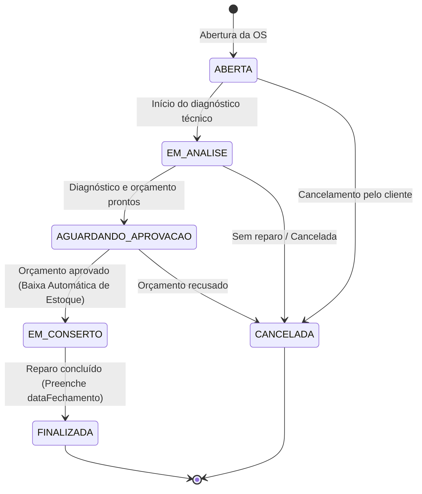

# 🛠️ TechRepair API — Sistema de Gestão de Assistência Técnica


A **TechRepair API** é uma API RESTful corporativa desenvolvida em **Java 21** com **Spring Boot 3** para informatizar e automatizar todo o fluxo operacional de uma **Assistência Técnica de Eletrônicos e Informática** — desde o cadastro de clientes e equipamentos, controle de catálogo de peças e estoque, até o ciclo completo de **Ordens de Serviço (OS)** com máquina de estados estrita, cálculo automático de orçamento e baixa transacional de estoque.

---

## 🎯 Visão Geral e Regras de Negócio

O projeto resolve gargalos reais de assistências técnicas por meio de regras de domínio sólidas:

1. **Gestão de Clientes e Equipamentos (`1:N`)**:
   - Validação de unicidade de documento (CPF/CNPJ) e e-mail.
   - Rastreabilidade dos equipamentos por número de série e vínculo obrigatório ao proprietário.
2. **Catálogo de Peças e Controle de Estoque**:
   - Controle de peças por código **SKU único**, preço de custo, preço de venda e alerta de **estoque mínimo**.
   - Operações de entrada e baixa manual com trava contra saldo negativo.
3. **Máquina de Estados da Ordem de Serviço**:
   - Geração automática de número de protocolo único (`OS-YYYYMMDD-XXXXXX`).
   - Validação de titularidade: impede abrir uma OS para um equipamento que não pertença ao cliente informado.
   - Transições de status estritamente controladas, impedindo saltos inválidos ou edições em ordens já encerradas.
4. **Orçamento Dinâmico e Baixa Automática de Estoque**:
   - Congelamento do preço unitário da peça no momento da inclusão no orçamento.
   - Recálculo automático de `valorPecas` e `valorTotal` (`valorMaoDeObra + valorPecas`) a cada item adicionado ou removido.
   - **Transação Atômica na Aprovação**: ao aprovar o orçamento (`AGUARDANDO_APROVACAO ➔ EM_CONSERTO`), o sistema deduz automaticamente todas as peças do estoque; se faltar saldo para qualquer item, toda a operação sofre *rollback*.
5. **Segurança Stateless JWT e Tratamento Global de Erros**:
   - Autenticação via **Spring Security 6 + JWT (Auth0)** com senhas criptografadas em **BCrypt** e perfis (`ADMIN`, `TECNICO`, `ATENDENTE`).
   - Padronização de erros HTTP (`400`, `401`, `404`, `409`, `500`) via `@RestControllerAdvice`.

---

## 🚀 Stack Tecnológica

| Camada / Ferramenta | Tecnologia |
| :--- | :--- |
| **Linguagem** | Java 21 LTS (Records, Pattern Matching Switch) |
| **Framework Principal** | Spring Boot 3.3.4 (Spring Web, Validation, Data JPA) |
| **Segurança** | Spring Security 6 + Auth0 Java-JWT + BCrypt |
| **Banco de Dados (Dev/Prod)** | PostgreSQL 16 (via Docker Compose) |
| **Banco de Dados (Testes)** | H2 Database (In-Memory) |
| **Versionamento de Schema** | Flyway Migrations (`V1` a `V5`) |
| **Documentação Interativa** | SpringDoc OpenAPI 3 / Swagger UI |
| **Testes Automatizados** | JUnit 5, Spring Boot Test, MockMvc, Spring Security Test |
| **Produtividade & Build** | Maven Wrapper (`mvnw`), Lombok, Dockerfile Multi-stage |

---

## 🔄 Máquina de Estados da Ordem de Serviço

O ciclo de vida de uma Ordem de Serviço segue estritamente o fluxo abaixo:



### Regras por Estado
- **`ABERTA` / `EM_ANALISE` / `AGUARDANDO_APROVACAO`**: Permite atualizar diagnóstico técnico, mão de obra e adicionar/remover peças do orçamento.
- **Transição `AGUARDANDO_APROVACAO ➔ EM_CONSERTO`**: Dispara a **baixa automática no estoque** de todas as peças vinculadas à OS dentro de uma transação (`@Transactional`).
- **`EM_CONSERTO`**: Bloqueia adição ou remoção de peças do orçamento.
- **`FINALIZADA` / `CANCELADA`**: Estados terminais imutáveis — preenchem `dataFechamento` (quando finalizada) e bloqueiam qualquer alteração de status, diagnóstico ou itens.

---

## 📌 Endpoints da API

### 🔓 Rotas Públicas

| Método | Endpoint | Descrição |
| :---: | :--- | :--- |
| `GET` | `/api/health` | Verifica disponibilidade e status da API |
| `POST` | `/api/auth/registrar` | Registra um novo usuário (`ADMIN`, `TECNICO`, `ATENDENTE`) |
| `POST` | `/api/auth/login` | Autentica o usuário e retorna o token Bearer JWT |
| `GET` | `/swagger-ui.html` | Interface interativa do Swagger UI (OpenAPI 3) |

### 🔒 Rotas Protegidas (Requerem Header `Authorization: Bearer <token>`)

#### 👥 Clientes (`/api/clientes`)
| Método | Endpoint | Descrição |
| :---: | :--- | :--- |
| `POST` | `/api/clientes` | Cadastra um novo cliente (valida CPF/CNPJ e e-mail únicos) |
| `GET` | `/api/clientes` | Lista todos os clientes cadastrados |
| `GET` | `/api/clientes/{id}` | Busca um cliente por ID |
| `GET` | `/api/clientes/{id}/equipamentos` | Lista todos os equipamentos pertencentes ao cliente |

#### 💻 Equipamentos (`/api/equipamentos`)
| Método | Endpoint | Descrição |
| :---: | :--- | :--- |
| `POST` | `/api/equipamentos` | Cadastra um equipamento vinculado a um cliente |
| `GET` | `/api/equipamentos` | Lista equipamentos (aceita filtro opcional `?clienteId={id}`) |
| `GET` | `/api/equipamentos/{id}` | Busca um equipamento por ID |

#### ⚙️ Peças e Estoque (`/api/pecas`)
| Método | Endpoint | Descrição |
| :---: | :--- | :--- |
| `POST` | `/api/pecas` | Cadastra nova peça no catálogo com SKU único |
| `GET` | `/api/pecas` | Lista todas as peças do catálogo |
| `GET` | `/api/pecas/estoque-baixo` | Lista peças ativas com saldo `<= estoqueMinimo` |
| `GET` | `/api/pecas/sku/{codigoSku}` | Busca peça pelo código SKU |
| `GET` | `/api/pecas/{id}` | Busca peça por ID |
| `PUT` | `/api/pecas/{id}` | Atualiza dados cadastrais e preços da peça |
| `DELETE` | `/api/pecas/{id}` | Inativa uma peça do catálogo |
| `PATCH` | `/api/pecas/{id}/estoque/entrada` | Registra entrada de unidades no estoque |
| `PATCH` | `/api/pecas/{id}/estoque/baixa` | Registra baixa manual (bloqueia saldo insuficiente) |

#### 📋 Ordens de Serviço e Orçamento (`/api/ordens-servico`)
| Método | Endpoint | Descrição |
| :---: | :--- | :--- |
| `POST` | `/api/ordens-servico` | Abre nova Ordem de Serviço (gera número único e status `ABERTA`) |
| `GET` | `/api/ordens-servico` | Lista Ordens de Serviço (aceita filtro opcional `?status=ABERTA`) |
| `GET` | `/api/ordens-servico/{id}` | Busca Ordem de Serviço por ID |
| `GET` | `/api/ordens-servico/numero/{numeroOs}` | Busca Ordem de Serviço pelo número gerado |
| `PATCH` | `/api/ordens-servico/{id}/diagnostico` | Atualiza diagnóstico técnico e valor de mão de obra |
| `PATCH` | `/api/ordens-servico/{id}/status` | Avança/altera status na máquina de estados |
| `POST` | `/api/ordens-servico/{osId}/itens` | Adiciona peça ao orçamento e recalcula valores da OS |
| `GET` | `/api/ordens-servico/{osId}/itens` | Lista as peças vinculadas à Ordem de Serviço |
| `DELETE` | `/api/ordens-servico/{osId}/itens/{itemId}` | Remove peça do orçamento e recalcula valores da OS |

---

## ⚙️ Como Executar o Projeto Localmente

### Pré-requisitos
- **Java 21** instalado
- **Docker** e **Docker Compose** instalados

### Passo 1: Clonar o repositório
```bash
git clone https://github.com/AlissonPazLopes/techrepair-api.git
cd techrepair-api
```

### Passo 2: Subir o banco de dados PostgreSQL com Docker
```bash
docker compose up -d
```

### Passo 3: Executar a aplicação
 As migrations do **Flyway** (`V1` a `V5`) serão aplicadas automaticamente na inicialização:
```bash
./mvnw spring-boot:run
```

### Passo 4: Explorar e testar pelo Swagger UI
1. Acesse no navegador: **[http://localhost:8080/swagger-ui.html](http://localhost:8080/swagger-ui.html)**
2. Utilize o endpoint **`POST /api/auth/registrar`** para criar seu usuário.
3. Autentique-se no endpoint **`POST /api/auth/login`** e copie o `token` retornado.
4. Clique no botão **`Authorize`** no topo do Swagger UI, cole o token JWT e teste todos os endpoints protegidos diretamente pela interface!

---

## 🧪 Executando os Testes Automatizados

A suíte conta com **24 testes de integração automatizados** (utilizando banco H2 em memória no perfil `test`, sem necessidade de Docker ativo para rodar os testes):

```bash
./mvnw clean test
```

---

## 👨‍💻 Autor

Desenvolvido por **Alisson Paz Lopes** — [GitHub](https://github.com/AlissonPazLopes)
